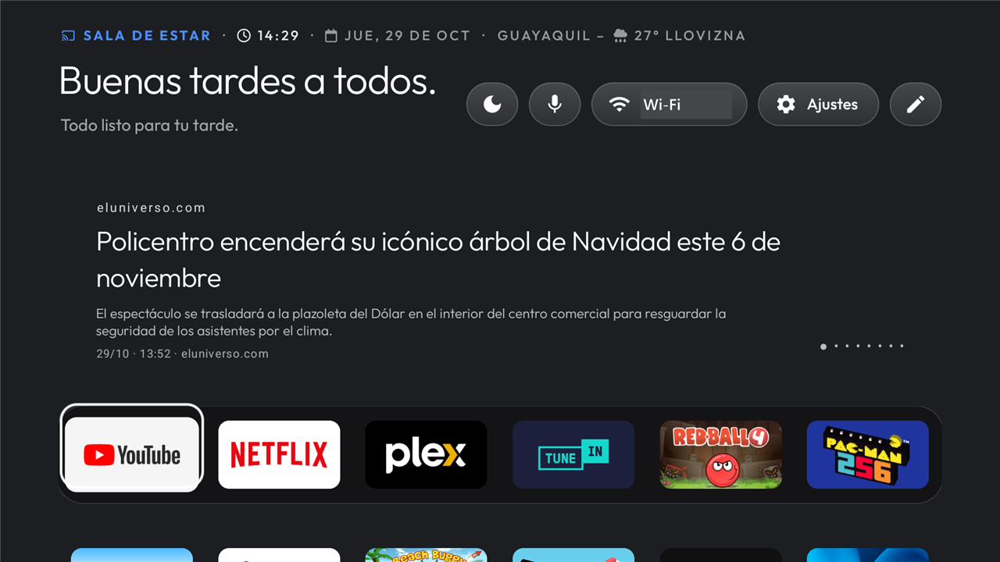
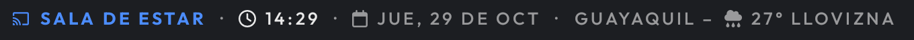
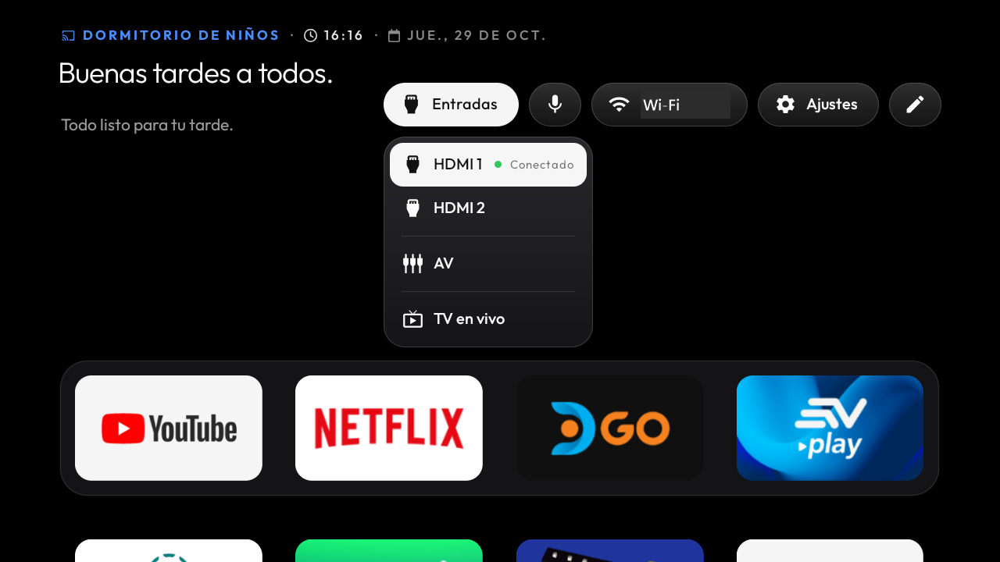
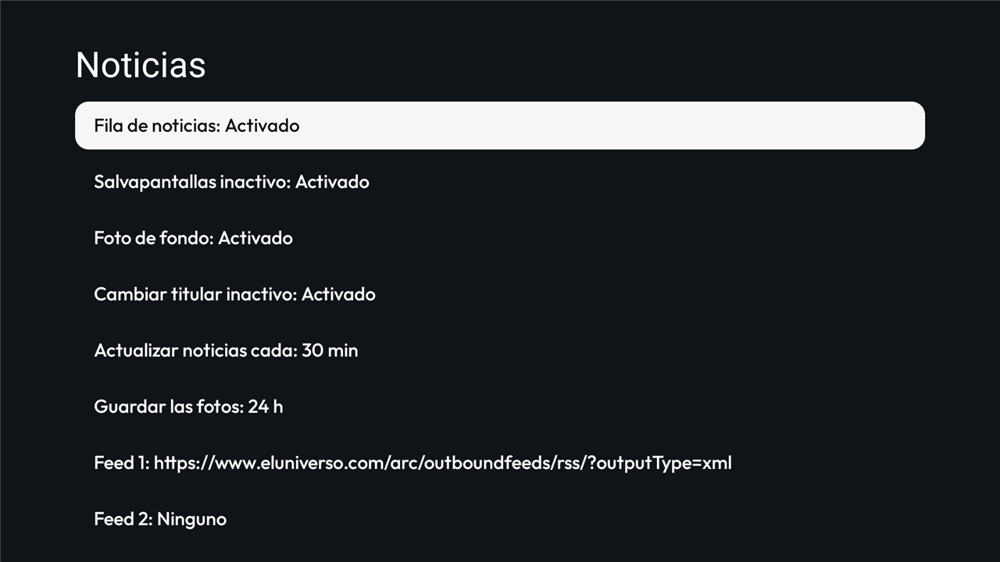

# New Home Google Chromecast (NHGC)

Launcher ligero para **Chromecast con Google TV** y **Android TV** (Android 9 o superior), basado en
[CleanYourTV / tv-vibehack](https://github.com/Gathin23/cleanyourtv) (licencia MIT).

En Google TV sustituye a Google TV Home como pantalla de inicio sin desactivarlo: Google TV Home sigue
instalado como mecanismo de recuperación y conserva su panel de ajustes rápidos. En Android TV es una
app de inicio normal.

> Versión estable **2026.10.29.004**, probada en dos Chromecast con Google TV (Android 14) y en un
> televisor TCL con Android TV 9. Consulta [docs/KNOWN-ISSUES.md](docs/KNOWN-ISSUES.md) antes de instalarlo.
>
> Las versiones siguen la fecha: `AAAA.MM.DD.NNN` (versionCode `AAMMDDNNN`).

## Capturas





| Entradas (Android TV) | Ajustes de noticias |
|---|---|
|  |  |

## Qué hace

| Función | Cómo se usa |
|---|---|
| Opciones del launcher | Botón con icono de lápiz en la barra superior (el mando del Chromecast no tiene tecla Menu) |
| Ajustes rápidos del sistema | Solo Google TV: pulsar **Inicio dos veces** (menos de 0,5 s) abre el panel nativo, también desde dentro de otra app |
| Pantalla de inicio | Google TV: el servicio de accesibilidad atiende la tecla Inicio y abre NHGC sin pasar por Google TV. Android TV: app de inicio predeterminada, sin servicio |
| Asistente de voz | Botón de micrófono; los resultados de búsqueda de Google TV se quedan en pantalla |
| Cabecera | Iconos de Font Awesome: nombre real del dispositivo · hora · fecha · ciudad – clima con su icono |
| Saludo | «Buenos días / Buenas tardes / Buenas noches», con tu nombre o «a todos», según la hora del dispositivo |
| Noticias RSS | Hasta 5 feeds propios (Opciones > Noticias); la fila se pliega al bajar a las apps |
| Salvapantallas | Botón con icono de luna: noticias a pantalla completa (solo con la fila de noticias activa) |
| Dock y apps | Mantener OK sobre un icono > Mover; todo el dock se mueve como una fila |
| Entradas | Solo si el dispositivo tiene entradas: HDMI, AV y la app de TV del fabricante (TCL) |
| Recuperación | Inicio 3 veces en 10 s abre un menú para reactivar el inicio original o restablecer los ajustes |

El diseño, los fondos, el salvapantallas de reloj y el lector de noticias son los del launcher original.

## Instalar

Ver [docs/GETTING-STARTED.md](docs/GETTING-STARTED.md). En resumen, con el paquete de la release
(APK, `instalar.ps1`, `revertir.ps1`, `reparar-inicio.ps1` y `adb`):

```powershell
.\platform-tools\adb.exe connect <IP-de-la-TV>:<puerto>
powershell -ExecutionPolicy Bypass -File .\instalar.ps1
```

Los scripts detectan si es Google TV o Android TV y solo activan el servicio en Google TV.
Para deshacerlo: `revertir.ps1`. Más detalles en [docs/RECOVERY.md](docs/RECOVERY.md).

## Compilar

Requisitos: JDK 17 o superior y Android SDK (platform 34, build-tools 34.0.0).

```powershell
cd launcher
.\gradlew.bat assembleRelease
```

Sin `launcher/keystore.properties` y `launcher/release.jks` el APK se firma con la clave de
depuración local. **Esos dos archivos no se suben nunca al repositorio** (están en `.gitignore`).

## Estructura

| Carpeta | Contenido |
|---|---|
| `launcher/` | El launcher (Android, Java) |
| `scripts/` | Herramientas ADB de medición y prueba (`nhgc-*`); ver la cabecera de cada script |
| `tools/` | Debloat reversible genérico heredado de CleanYourTV (`disable`, `restore`, `tv.py`) |
| `examples/` | Listas de debloat de otros televisores, como ejemplo del formato |
| `tests/` | Tests de los scripts y herramientas (Python y bash) |
| `docs/` | Documentación |

## Documentación

- [Primeros pasos](docs/GETTING-STARTED.md)
- [Recuperación](docs/RECOVERY.md)
- [Problemas conocidos](docs/KNOWN-ISSUES.md)
- [Personalización](docs/PERSONALIZATION.md) y [presets de experiencia](docs/EXPERIENCE-PRESETS.md)
- [Tarjetas de entradas](docs/INPUT-CARDS.md)
- [Traducciones](docs/LOCALIZATION.md)
- [Procedencia del código](docs/PROVENANCE.md) y [proyectos relacionados](docs/RELATED-PROJECTS.md)
- [Cómo contribuir](CONTRIBUTING.md)

## Licencia y créditos

MIT. Ver [LICENSE](LICENSE), [NOTICE.md](NOTICE.md) y [launcher/NOTICE.md](launcher/NOTICE.md).
Proyecto no afiliado a Google. Las marcas pertenecen a sus propietarios.
